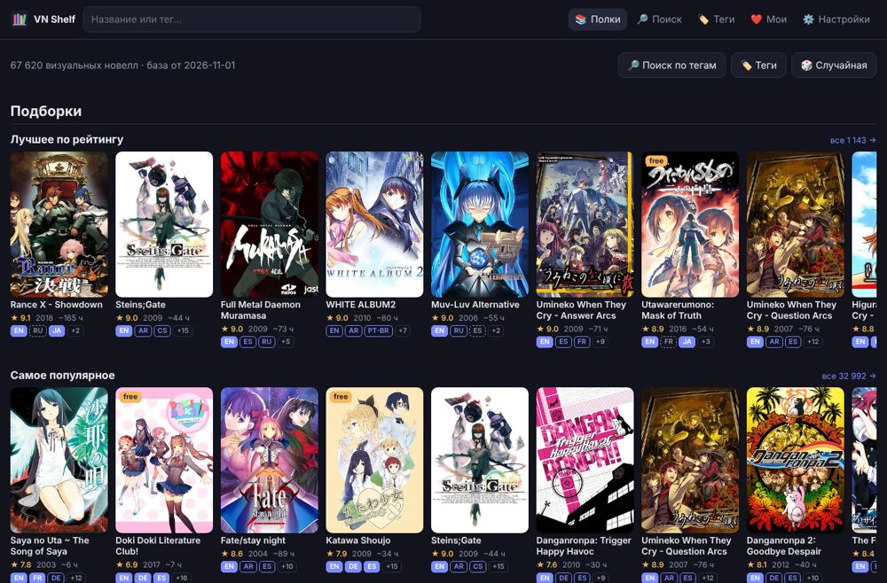
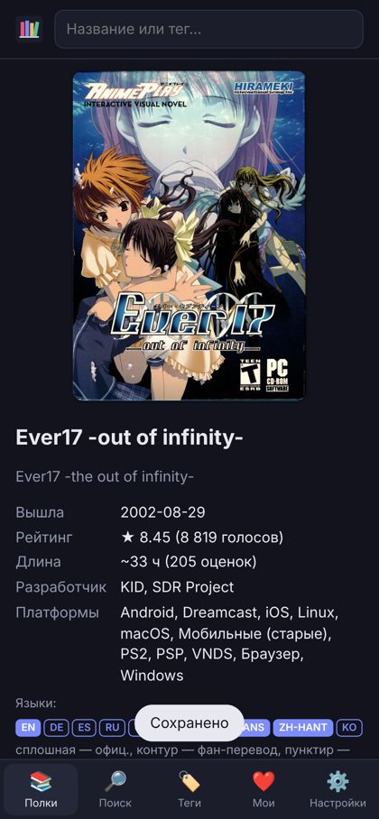

# VN Shelf — офлайн-каталог визуальных новелл

Вся база [VNDB](https://vndb.org) у вас на компьютере или телефоне: около 67 тысяч визуальных новелл,
разложенных по полкам и тегам, с удобным поиском и ссылками на то, где игру скачать или купить.
Работает без интернета.

<p>
  
  
</p>

## Скачать

| Система | Что скачать | Как запустить |
|---|---|---|
| **Windows** 10/11 (x64) | `VNShelf-…-windows-x64.zip` из [релизов для ПК](https://github.com/Vsaisai/Ai_test/releases?q=pc-v&expanded=true) | распаковать → `Start VN Shelf.bat` |
| **Linux** (x64) | `VNShelf-…-linux-x64.zip` из [релизов для ПК](https://github.com/Vsaisai/Ai_test/releases?q=pc-v&expanded=true) | распаковать → `./start-vn-shelf.sh` |
| **macOS** (Apple Silicon) | `VNShelf-…-macos-arm64.zip` из [релизов для ПК](https://github.com/Vsaisai/Ai_test/releases?q=pc-v&expanded=true) | распаковать → `Start VN Shelf.command` |
| **Android** 7.0+ | `VNShelf-….apk` из [релизов для Android](https://github.com/Vsaisai/Ai_test/releases?q=mobile-v&expanded=true) | установить APK |

При первом запуске нажмите **«Скачать базу VNDB»** (~190 МБ, 1–3 минуты). Загрузка докачивается после обрыва
связи, на телефоне её прогресс виден в уведомлении.

Все версии — на странице [Releases](https://github.com/Vsaisai/Ai_test/releases).

## Возможности

- **Полки.** Подборки (лучшее, популярное, новинки, бесплатные, короткие), жанры, «кто с кем» (отомэ, юри, BL),
  игры с геймплеем.
- **Каталог тегов на русском.** Жанр, сеттинг, сюжет и темы, главный герой, романтика, формат и геймплей —
  касанием тег становится желательным, обязательным или исключённым. Полное дерево ~3 000 тегов VNDB — на
  отдельной вкладке.
- **Поиск по тегам.** Тег можно сделать **обязательным** (!), **желательным** (~) или **исключённым** (−).
  Сначала показываются новеллы со всеми желательными тегами, потом по числу совпадений, потом по алфавиту.
  На странице новеллы видно, какие теги из поиска у неё нашлись.
- **Читаемые языки.** По умолчанию — только то, что вышло на английском или другом языке не на иероглифах.
  Видно, где перевод официальный, фанатский или машинный.
- **Где взять.** Официальные бесплатные загрузки (itch.io и др.), магазины (Steam, GOG, JAST, MangaGamer,
  DLsite…) с ценами Steam, сайт разработчика для сравнения, фанатские переводы. Есть каталоги переводов
  ([vngames.ru](https://vngames.ru) — прямая ссылка на страницу новеллы, AniVisual, F95zone).
- **Перевод.** Описания и теги переводятся на русский (машинный перевод с кэшем), на странице новеллы
  можно переключиться на оригинал. Удержание тега показывает, что он значит.
- **ПК или телефон.** Можно показывать только новеллы, в которые можно играть на ПК или на телефоне.
- **Мои полки:** «Хочу», «Читаю», «Прочитано», «Брошено», «Любимое».
- **Обновления сами.** Android-приложение обновляется изнутри, без браузера.
- **Новые релизы VNDB.** Новые новеллы и релизы подтягиваются через API VNDB. Если база сильно отстала,
  приложение предложит скачать её заново целиком.
- **ПК и телефон.** На ПК есть режим для домашней сети: можно открыть каталог с телефона по адресу
  `http://IP-компьютера:8080`. Android-приложение работает полностью автономно.

## Как устроено

```
vndb-explorer/
├── crates/core     ядро: импорт дампа VNDB, база SQLite, поиск, полки, «где взять», синхронизация
├── crates/server   vndb-web: локальный сервер — REST API и веб-интерфейс
├── crates/mobile   библиотека для Android (тот же сервер внутри приложения)
├── crates/cli      консольный клиент онлайн-API VNDB
├── web/            интерфейс (HTML/CSS/JS, PWA)
├── desktop/        сборка ПК-версии: папки server/ и client/
└── mobile/android  Android-приложение
```

`desktop/` развивается в ветке `beta`, `crates/mobile` и `mobile/` — в ветке `mobile`.

Подробная документация: [vndb-explorer/README.md](vndb-explorer/README.md) (запуск, настройки, свои полки и
каталоги, REST API) и [docs/MOBILE.md](vndb-explorer/docs/MOBILE.md) (Android, сборка APK, выпуск версий).

### Ветки

| Ветка | Что в ней |
|---|---|
| `main` | основная |
| `beta` | разработка ядра и ПК-версии; при изменении `vndb-explorer/VERSION` собирается релиз `pc-v…` |
| `mobile` | Android-приложение; при изменении `vndb-explorer/mobile/VERSION` собирается релиз `mobile-v…` |

### Сборка из исходников

Нужен [Rust](https://rustup.rs) (stable):

```bash
cd vndb-explorer
cargo build --release
./target/release/vndb-web serve
```

Затем откройте <http://127.0.0.1:8080>. Сборка APK описана в [docs/MOBILE.md](vndb-explorer/docs/MOBILE.md).

## Данные и безопасность

Данные — [VNDB](https://vndb.org/d14), лицензия ODbL. Приложение не размещает игры и файлы: оно только
показывает ссылки, известные VNDB, или ссылки на поиск по сторонним сайтам.
О поддерживаемых версиях и о том, как сообщить об уязвимости, — в [SECURITY.md](SECURITY.md).
