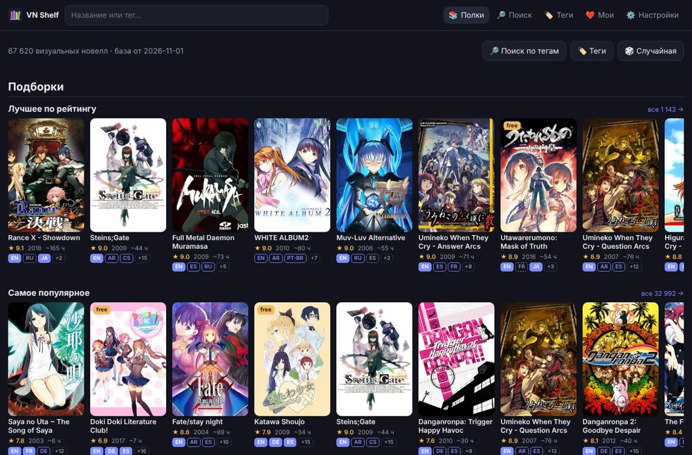
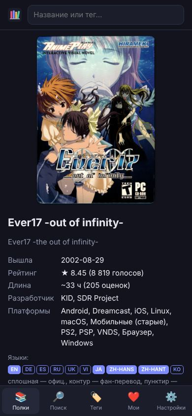

# VN Shelf / vndb-explorer

Офлайн-каталог визуальных новелл на основе [VNDB](https://vndb.org): **вся база VNDB локально**
(≈67 тыс. новелл, 160 тыс. релизов, 3 тыс. тегов, включая 18+), разложенная по полкам, с удобным
поиском по тегам и ссылками «где скачать / купить». Работает в браузере на ПК и на телефоне.

 

## Что умеет

* **Полная локальная копия VNDB.** Импорт официального дампа базы (`vndb-db-latest.tar.zst`, ~190 МБ):
  новеллы, названия на всех языках, теги (голоса пользователей агрегируются так же, как на VNDB),
  релизы, платформы, издатели, внешние ссылки, скриншоты, связи между новеллами. Импорт потоковый:
  около 30 секунд вместе со скачиванием и ~15 МБ оперативной памяти, база — ~150 МБ SQLite. После этого всё работает без интернета (обложки
  скачиваются при первом показе и кешируются).
* **Полки.** Главная страница — подборки и жанры: лучшее, популярное, новинки, бесплатные,
  короткие/длинные, романтика, драма, накиге/утсуге, мистика, хоррор, sci-fi, путешествия во
  времени, попаданцы, отомэ, юри, BL, RPG, симуляторы… и отдельный раздел **18+** (нукиге,
  сюжет + 18+, NTR, юри/яой 18+ и т.д.). Полки настраиваются (см. ниже).
* **Теги по категориям.** Все теги разложены деревом: Тема / Персонажи / Сеттинг / Сюжет / Стиль →
  подкатегории → теги, с числом новелл и фильтром. На странице новеллы теги тоже сгруппированы.
* **Поиск по тегам:**
  * `!` **обязательно** — тег должен быть (подтеги считаются);
  * `~` **желательно** — сначала новеллы со *всеми* желательными тегами, затем по числу совпадений
    (по убыванию), затем по алфавиту;
  * `−` **исключить**.
  Плюс название, платформы, длина, год, мин. голосов/рейтинг, только бесплатные, сортировки.
  Ссылки на поиск можно сохранять и отправлять — всё состояние в адресе.
* **Языки.** По умолчанию показываются новеллы, доступные на английском или любом другом языке
  **не на иероглифах**; название — английское, иначе другое читаемое, иначе ромадзи. Видно,
  какой перевод официальный, фанатский или машинный.
* **Где взять:** официальные бесплатные загрузки (itch.io и т.п.) → магазины (Steam, GOG, JAST,
  MangaGamer, DLsite…, с кнопкой «Цены в Steam») → покупка у разработчика/издателя (для сравнения
  со Steam) → фанатские переводы и патчи. Если на VNDB ничего нет — ссылки на поиск по itch.io,
  F95zone, Steam, GOG, DLsite.
* **Каталоги переводов и сообщества** (vngames.ru, AniVisual, F95zone…). Для сайтов с картой сайта
  (vngames.ru) приложение строит индекс и даёт **прямую ссылку на страницу новеллы** — названия из
  VNDB транслитерируются так же, как это делает сайт (сейчас сопоставляется ~1 800 из 2 640 страниц;
  остальное — в основном русские проекты, которых нет на VNDB). Для остальных — ссылка на поиск.
  Список настраивается файлом `sources.json` (см. ниже).
* **Обновления.** Новые новеллы и релизы подтягиваются через API VNDB за секунды. Если база отстала
  сильно (больше 1 500 новых новелл, 6 000 релизов или 90 дней с полной загрузки), приложение
  предлагает полную загрузку свежего дампа — или делает её само, если так выбрано в настройках.
* **18+.** Включено по умолчанию; откровенные обложки размываются (нажать «18+», чтобы показать).
  В настройках можно скрыть 18+ полностью или отключить размытие.
* **Мои полки:** «Хочу», «Читаю», «Прочитано», «Брошено», «Любимое» — хранятся на сервере
  (`user.sqlite`), общие для ПК и телефона и не стираются при обновлении базы.
* **PWA:** на телефоне можно «Установить приложение» / «На экран Домой».

## Готовые сборки

В [GitHub Releases](https://github.com/Vsaisai/Ai_test/releases):

* **ПК** (`pc-v*`): zip для Windows x64, Linux x64 и macOS (Apple Silicon). Распаковать и запустить
  `Start VN Shelf.bat` / `./start-vn-shelf.sh` / `Start VN Shelf.command` — поднимется сервер и
  откроется окно приложения. Внутри две папки:
  * `server/` — `vndb-web`, скрипты запуска (локально / для телефона в Wi-Fi), `data/` с базой и вашими полками;
  * `client/` — `web/` (интерфейс, сервер берёт его отсюда), `open-client` (окно-приложение в Edge/Chrome),
    `cli/vndb-explorer` (консольный клиент).
* **Android** (`mobile-v*`): APK, см. [docs/MOBILE.md](docs/MOBILE.md).

Сборки создаёт GitHub Actions: `.github/workflows/desktop.yml` — при пуше в `beta`, если для номера из
`vndb-explorer/VERSION` ещё нет релиза. Локально: `cargo build --release -p vndb-web -p vndb-explorer`
и `./desktop/package.sh linux-x64` (или `windows-x64`, `macos-arm64`).

## Быстрый старт (из исходников)

Нужен Rust (stable). Из папки `vndb-explorer`:

```bash
cargo build --release
```

```bash
./target/release/vndb-web import
```

```bash
./target/release/vndb-web serve
```

Откройте <http://127.0.0.1:8080>. Базу можно скачать и из интерфейса (кнопка на первом экране или
«Настройки → База данных → Обновить базу из VNDB»). Дамп VNDB обновляется ежедневно.

### С телефона

Запустите сервер так, чтобы он был доступен в домашней сети, и откройте `http://IP-компьютера:8080`
в браузере телефона:

```bash
./target/release/vndb-web serve --addr 0.0.0.0:8080
```

> Сервер не требует пароля: открывайте его только в доверенной сети.

### Опции

| Команда | Что делает |
|---|---|
| `vndb-web import [--file dump.tar.zst]` | скачать дамп VNDB (или взять готовый файл) и пересобрать базу |
| `vndb-web sync [--check]` | подтянуть новые новеллы и релизы через API VNDB (`--check` — только показать отставание) |
| `vndb-web sources` | обновить индексы каталогов (vngames.ru) и показать, сколько страниц сопоставлено |
| `vndb-web serve [--addr 127.0.0.1:8080] [--auto-import] [--web DIR]` | запустить веб-интерфейс (`--web` — брать интерфейс из папки, а не встроенный) |
| `--data DIR` / `VNDB_DATA=DIR` | папка данных (по умолчанию `~/.local/share/vndb-explorer`, на Windows `%APPDATA%\vndb-explorer`) |

В папке данных: `catalog.sqlite` (база VNDB), `user.sqlite` (ваши полки и индексы каталогов),
`img/` (кеш обложек), `shelves.json` и `sources.json` (необязательно — свои полки и каталоги).

### Свои полки

Скопируйте [`crates/core/assets/shelves.json`](crates/core/assets/shelves.json) в папку данных как
`shelves.json` и правьте. Каждая полка — это поисковый запрос:

```json
{ "id": "my-scifi", "title": "Sci-fi без 18+", "query": { "must": ["Science Fiction"], "exclude": ["Sexual Content"], "sort": "rating", "min_votes": 50 } }
```

Поля `query` — те же, что у `POST /api/search` (см. ниже). `"adult": true` прячет полку, когда 18+ выключено.

### Свои каталоги

Скопируйте [`crates/core/assets/sources.json`](crates/core/assets/sources.json) в папку данных как
`sources.json`. Источник с поиском:

```json
{ "id": "mysite", "name": "MySite", "lang": "ru", "kind": "community", "search": "https://example.org/search?q={q}" }
```

Если у сайта есть sitemap, а адреса страниц — это транслитерация названия, добавьте индекс:
`"index": { "sitemap": "https://example.org/sitemap.xml", "prefix": "https://example.org/novels/" }`.
`"kind": "store_search"` — показывать только когда VNDB не знает ни одного магазина.

## Устройство

```
vndb-explorer/
├── crates/core     vndb-core: импорт дампа, SQLite, индекс в памяти, поиск, полки, «где взять»
├── crates/server   vndb-web: HTTP-сервер (axum) — REST API, кеш обложек, встроенный интерфейс
├── crates/cli      vndb-explorer: консольный клиент онлайн-API VNDB (из первой версии)
├── crates/mobile   libvnshelf.so: JNI-обёртка, запускает сервер внутри Android-приложения
├── mobile/android  Android-оболочка (Java + WebView), mobile/build-apk.sh — сборка APK
├── web/            интерфейс: HTML/CSS/ES-модули без сборки, PWA (manifest + service worker)
├── desktop/        скрипты запуска и упаковщик ПК-версии (server/ + client/)
└── docs/           документация (мобильное приложение)
```

* **core** не зависит от веба: его можно встроить в мобильное или десктопное приложение напрямую.
* **Интерфейс** общается с сервером только через `web/js/api.js`; адрес сервера настраивается.

### REST API

| Метод | Путь | Описание |
|---|---|---|
| GET | `/api/status` | состояние базы и импорта |
| POST | `/api/import` | полная загрузка свежего дампа |
| GET | `/api/updates[?force=1]` | насколько база отстала от VNDB (кешируется на 6 ч) |
| POST | `/api/sync` | подтянуть новые новеллы и релизы через API |
| GET | `/api/sources`, POST `/api/sources/refresh` | каталоги и их индексы |
| GET | `/api/tags` | все теги с родителями/детьми и числом новелл |
| GET | `/api/tags/{id}` | тег: описание, путь в дереве |
| POST | `/api/search` | поиск (тело — `SearchRequest`) |
| POST | `/api/shelves` | все полки с первыми N новеллами |
| POST | `/api/shelves/{id}` | одна полка постранично |
| GET/PUT | `/api/shelves-config` | конфигурация полок |
| GET | `/api/vn/{id}?langs=en,ru` | новелла: теги по категориям, релизы, «где взять», скриншоты |
| GET | `/api/vn/{id}/prices?cc=us` | текущие цены Steam (нужен интернет) |
| POST | `/api/random` | случайная новелла под фильтр |
| GET | `/api/my`, PUT/DELETE `/api/my/{id}` | личные полки |
| GET | `/img/{cv,cv.t,sf,st}/NN/ID.jpg` | обложки/скриншоты (кешируются локально) |

`SearchRequest` (все поля необязательны): `text`, `must[]`, `want[]`, `exclude[]` (id `g123` или
имя тега), `min_match`, `spoiler` (0–2), `min_level` (0–3), `lang_mode` (`readable`/`list`/`any`),
`langs[]`, `allow_mtl`, `ero` (`show`/`hide`/`only`), `platforms[]`, `length_min`/`length_max`
(минуты), `year_from`/`year_to`, `min_votes`, `min_rating`, `freeware`, `hide_cancelled`,
`released_only`, `ids[]`, `sort` (`relevance`, `rating`, `votes`, `newest`, `oldest`, `title`,
`shortest`, `longest`), `offset`, `limit`.

### Мобильное приложение

Ветка `mobile`: автономное Android-приложение (APK в GitHub Releases, теги `mobile-v*`) — вся база
на телефоне, новые релизы подтягиваются сами. Подробности и сборка — [docs/MOBILE.md](docs/MOBILE.md).

## Консольный клиент

`crates/cli` — первая версия (онлайн-API VNDB): `vndb-explorer tags`, `search -m/-w/-x`, `vn`,
`links`. Подробности — `vndb-explorer --help`.

## Тесты

```bash
cargo test --workspace
```

## Данные и лицензия

Данные: [VNDB](https://vndb.org/d14), лицензия ODbL (описания новелл могут иметь свои условия).
Приложение не размещает игры и файлы — только показывает ссылки, известные VNDB, или ссылки на поиск.
